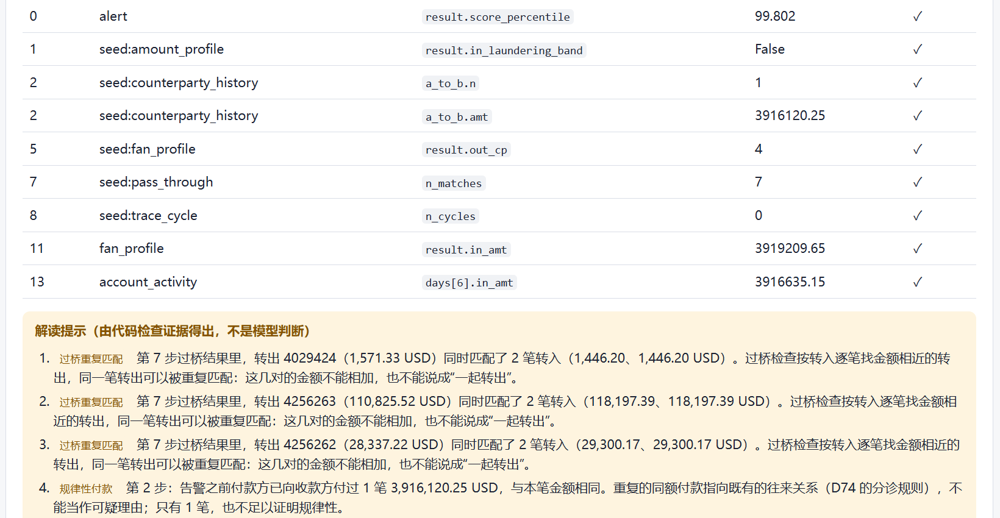
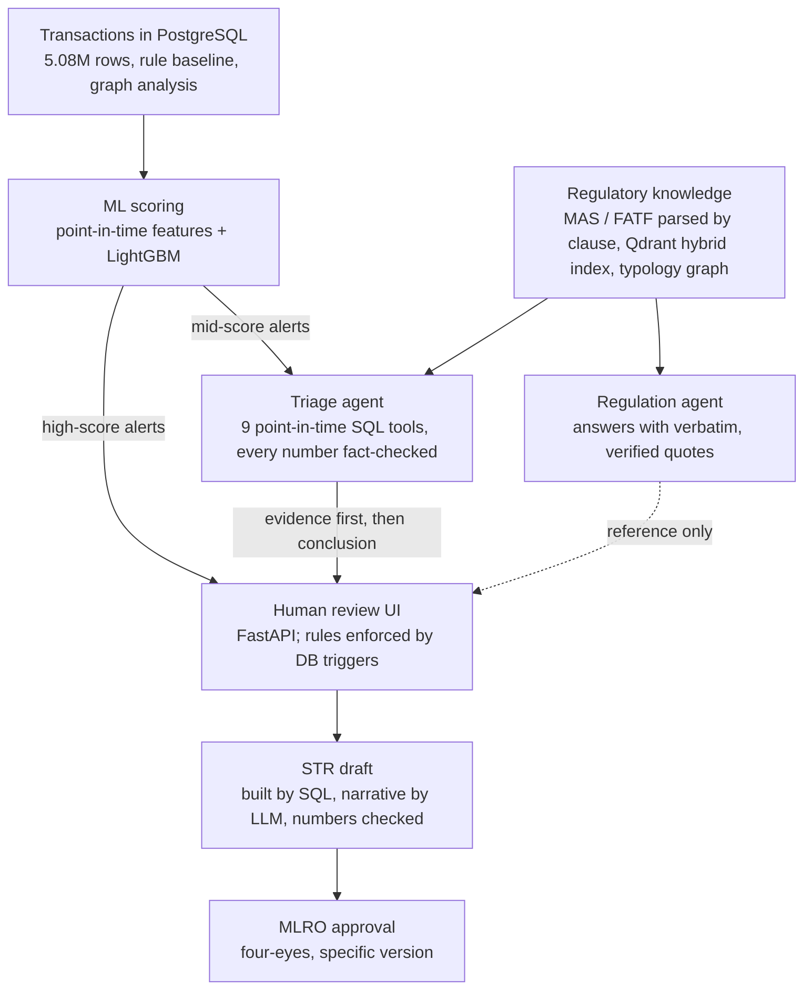
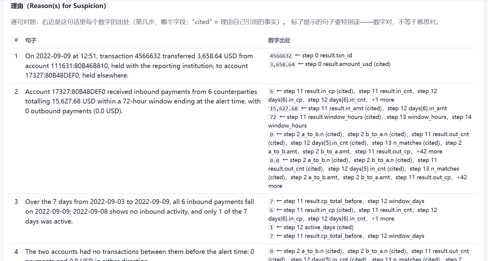
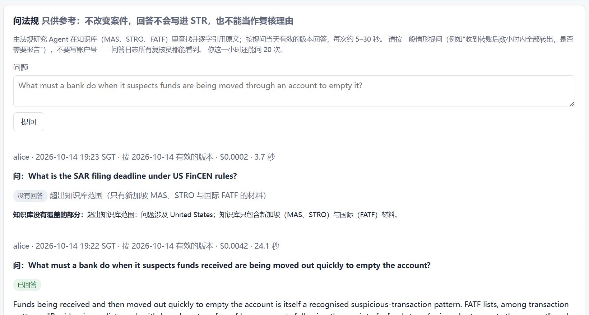

# SentryAML

**An end-to-end anti-money-laundering (AML) alert workflow: rules → ML scoring → LLM agents that investigate and cite regulation → human review with an audit trail → a drafted Suspicious Transaction Report (STR).**

[中文简介](README.zh-CN.md) · [Design decisions & lessons (decision log, in Chinese)](docs/decisions.md)

> Portfolio project built on a public **synthetic** dataset (IBM AMLworld, HI-Small: 5.08M transactions) and public Singapore regulation (MAS, STRO) plus FATF guidance. It is not production software and contains no real customer data.

| | Result | Measured on |
|---|---|---|
| Alert volume | Same recall as the rule engine with **2,216** alerts instead of **354,479** (−99.4%); precision 0.15% → **24.4%** | Out-of-time test set, 845k transactions, run once |
| Cited regulatory answers | **128/128** claims verified word-for-word against the source clause; citation accuracy **1.000**; 0 false refusals | Held-out test questions, run once |
| Triage agent | **60/60** conclusions pass programmatic fact-checking (every number traced to a tool result); ~1 cent and 33 s median per alert | Frozen test sample, run once |



---

## What it does

An analyst's day in this system:

1. **Rules and an ML model** score every transaction. The model replaces most rule alerts; high-score alerts go straight to a human.
2. **A triage agent** investigates mid-score alerts with nine point-in-time SQL tools (it can only see transactions before the alert, and a least-privilege database role means it cannot read the labels). Every number in its conclusion is checked against the tool output that produced it.
3. **A human reviewer** claims the case in a web UI, reads the evidence *before* the agent's conclusion, and confirms or closes it. The rules — state machine, four-eyes approval, append-only audit trail, claim leases — live in PostgreSQL triggers, so no entry point (UI, API, CLI, raw SQL) can bypass them.
4. **An STR draft** is assembled from SQL (accounts, transactions, attachment) and its narrative is drafted by an LLM, then checked: every number must come from the evidence. The reviewer sees each sentence next to the source of each number, with deterministic hints on sentences that are likely to over-claim.
5. **A regulation agent** answers questions such as "what must a bank do when funds are moved out quickly to empty an account?" with verbatim, verified quotes from MAS Notice 626 and FATF guidance. Answers are reference only and never flow into the STR automatically.
6. A **second person (MLRO)** approves a specific draft version.

## Architecture



## Layer by layer

Each bullet links to the decision record where the choice and its evidence are written up.

**Data and rules** — 5.08M synthetic transactions in PostgreSQL with composite account keys and `NUMERIC` money (D02, D06). The rule baseline flags laundering at a **99.85%** false-positive rate (662 alerts reviewed per true hit), and a threshold sweep shows no setting reaches 80% recall with 5% precision (D14). A recursive-CTE cycle tracer recovers **49/49** labelled cycles from the start account alone in under 10 ms (D19); 15 "clearing-layer" accounts carrying 5% of all volume are identified and pruned from traversal (D17). Neo4j was considered and not used (D38).

**ML scoring** — time-based train/validation/test split, point-in-time features (D22, D23). LightGBM reaches AUC-PR **0.50** (95% CI 0.47–0.53) on the out-of-time test set against a random baseline of 0.0011 and logistic regression at 0.069 (D29). A leakage audit by ablation (D35), SHAP analysis (D33) and a post-hoc study locate the blind spot: follow-on transactions of already-known laundering accounts (D37). Optuna's validation gain was smaller than the measured noise floor, so the simpler model was kept (D28).

**Regulatory knowledge (RAG)** — five MAS documents and FATF guidance parsed by clause and cross-checked against MAS's own revision markers (D41); 724 cross-references extracted (D43); contextual retrieval for 1,295 chunks for about US$1.3 using prefix caching (D46); Qdrant hybrid retrieval with date filtering, reranking and clause-number routing — test Recall@10 **0.90**, with the drop from dev (0.97) reported (D51, D52). Cited answers are verified word-for-word and refuse when the sources do not answer (D53–D57). A hand-written tool-calling agent (search, fetch clause by number, submit-and-verify) raises key-point coverage from **0.83 to 1.00** on a test set built for multi-hop questions (paired difference +0.17, bootstrap 95% CI [+0.03, +0.33]); HyDE and fixed two-round retrieval were tested and rejected (D60–D67).

**Triage agent** — nine point-in-time investigation tools behind a label-free view and a least-privilege role (D68); a deterministic first round (D73); a submission format whose every number is checked (D74). On the score tier where the model is weakest, at equal review volume the agent's precision is **10.3%** vs **6.4%** for score ordering; the 95% interval for the difference includes zero, and this is reported as such (D77). The alternative use the plan also compared — letting the agent triage the high-score tier too — was negative on test, which supports routing high scores straight to humans.

**Human review and STR** — review state machine, four-eyes rule, stale-page protection and append-only events enforced by triggers (D78). The STR's structured part is built by SQL and re-checked by the database (11 tampering cases rejected, D79); the narrative is one LLM call plus five programmatic checks (D80). On the test set the drafts passed **15/15**; two raters agreed on **87%** of sentences, and the second rater found 5/45 sentences whose numbers were right but whose meaning over-claimed (D84). That finding shaped the UI.

**Review web app** — FastAPI with argon2id passwords, server-side sessions (only the token's hash is stored), CSRF tokens, and identity taken only from the session (D85). Server-rendered pages under a strict Content-Security-Policy; buttons call the same tested JSON API. Each narrative sentence is shown next to the source of every number; three deterministic hints flag the over-claim patterns found in D84 (D86); reviewers can ask the regulation agent from the case page, with a concurrency cap, an hourly quota and a block on account numbers in questions (D87).





## How results were kept honest

- **Dev/test discipline.** Every comparison has an adoption rule written down before the systems were run; the test split is run once and the scripts refuse to re-run it.
- **Negative and null results are reported.** The triage agent's main result has an interval that includes zero; Optuna, HyDE and two-round retrieval did not help; the conservative feature set collapsed on test (D36).
- **In-sample is labelled in-sample.** The UI hint rules were written while looking at the 85 rated sentences; their hit rate there is not evidence they work, and they were frozen after four versions (D86).
- **"What I got wrong"** — a section of the decision log lists assumptions that the data contradicted and what changed as a result.

## Limitations

- Synthetic data: no names, IDs or addresses, and only about ten days of usable transactions, while an STR normally covers three months.
- The knowledge base holds only Singapore (MAS, STRO) and FATF material.
- Test samples are small (tens of alerts, tens of questions); intervals are wide and are reported.
- Reading hints cover three known over-claim patterns; other kinds of meaning errors still rely on the human reader.
- Single-node demo: the concurrency cap is per process, sessions are stored in PostgreSQL, and there is no job queue. The scaling path is described in D87.

## Quick start

Requirements: Docker, Python 3.12, a DeepSeek API key (LLM) and a SiliconFlow API key (bge-m3 embeddings and reranking).

```bash
cp .env.example .env               # fill in passwords, keys and a 32+ character SESSION_SECRET
docker compose up -d               # PostgreSQL 16 on port 5433, Qdrant on 6333
python -m venv .venv && .venv/Scripts/activate      # macOS/Linux: source .venv/bin/activate
pip install -r requirements.txt
```

**Data is not included.** Download the IBM *Transactions for Anti Money Laundering* dataset (HI-Small files) into `data/raw/`, and the regulatory PDFs listed in [`config/corpus.yaml`](config/corpus.yaml) into `data/corpus/raw/`.

Build the system stage by stage. SQL files run in numeric order inside the container, for example `docker compose exec -T postgres psql -U sentry -d sentryaml -f /sql/001_create_tables.sql`. Each Python script's docstring states its prerequisites.

| Stage | Main scripts |
|---|---|
| Load data | `load_dimensions.py`, `load_transactions.py`, `load_patterns.py` |
| Features and model | `export_features.py`, `train_lr.py`, `train_lgbm.py`, `evaluate_test.py`, `shap_analysis.py` |
| Knowledge base | `register_corpus.py`, `kb_load.py`, `kb_typology_load.py`, `kb_context.py`, `kb_index.py` |
| Agents | `kb_agent.py`, `alert_queue.py`, `triage_agent.py` |
| Review | `review.py`, `str_draft.py`, `str_narrative.py`, `review_auth.py set-password <id>`, `review_api.py` |

Run the review UI at <http://127.0.0.1:8000/> with `python scripts/review_api.py` (interactive API docs at `/api/docs`).

## Tests

Most tests run inside a transaction that is rolled back at the end, and the ones touching an LLM use a scripted fake model, so they cost nothing and leave no data behind.

| Command | What it checks |
|---|---|
| `python scripts/review.py smoke` | Review state machine, roles, four-eyes, append-only (26 checks) |
| `python scripts/str_draft.py selftest` | STR assembly and database cross-checks, including tampering cases |
| `python scripts/str_narrative.py selftest` | Narrative checks with a fake model |
| `python scripts/review_api_test.py` | API end to end: sessions, CSRF, identity, claim and lease (46 checks) |
| `python scripts/review_web_test.py` | Pages, CSP, escaping, draft flow, reading hints (50 checks) |
| `python scripts/review_reg_test.py` | Ask-regulation: quota, concurrency, data minimisation, audit (27 checks) |
| `python scripts/inv_smoke.py` | Investigation tools: permissions, reconciliation, mutation checks |
| `python scripts/agent_regress.py` | Replays recorded agent runs from cache and requires byte-identical requests |

## Repository layout

```
config/    corpus manifest, evaluation question sets, typology knowledge graph
docs/      decisions.md (design decisions, lessons, numbers) and screenshots
reports/   frozen evaluation splits and results referenced by the decision log
scripts/   pipeline, agents, review API and UI (templates/, static/), tests
sql/       numbered schema migrations, roles, triggers; diag_*.sql investigations
tests/     golden records for the shared agent loop
```

## Tech stack

PostgreSQL 16 (recursive CTEs, triggers, least-privilege roles) · Python 3.12 · LightGBM, scikit-learn, Optuna · Qdrant (dense bge-m3 + custom BM25) · DeepSeek via the OpenAI SDK, with hand-written tool loops and no agent framework · FastAPI, Jinja2, argon2 · Docker Compose

## License and data

Code is released under the [MIT License](LICENSE). The IBM AMLworld dataset and the MAS/FATF documents are **not** redistributed; download them from their sources and follow their terms. `config/typology_kg.yaml` contains short quotations with clause references for citation.
